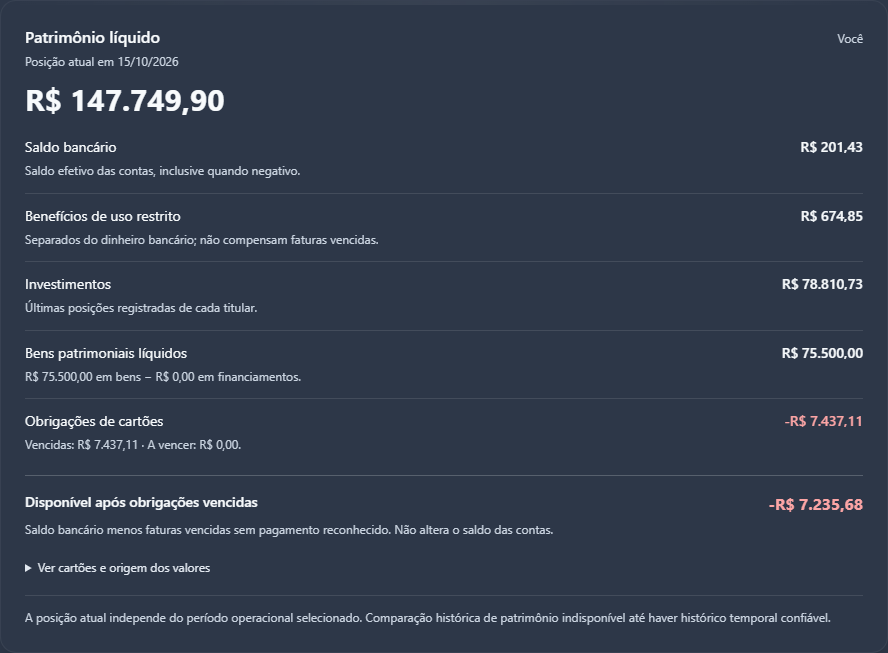
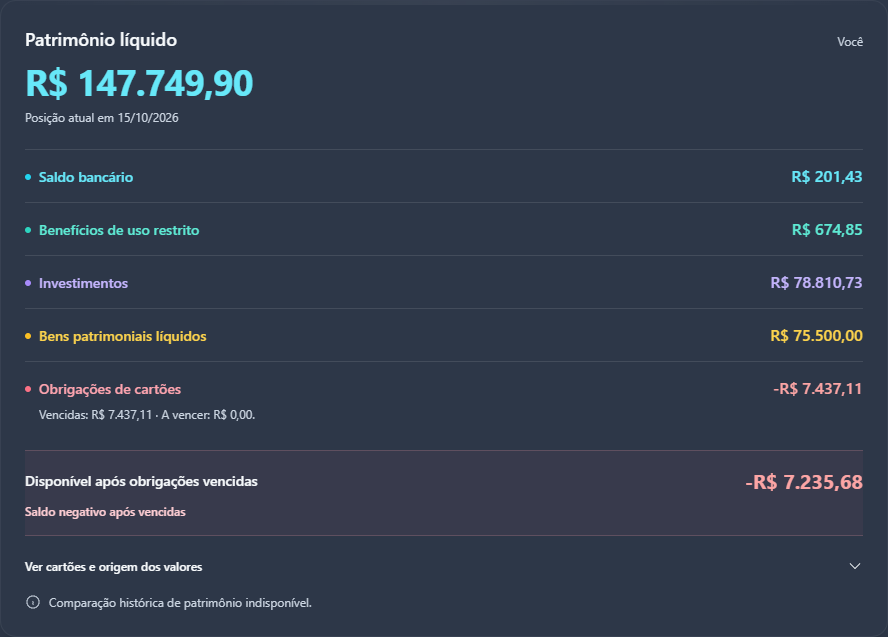
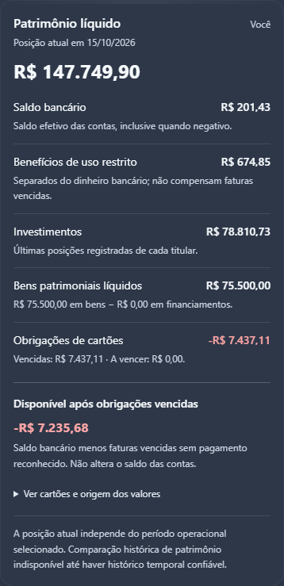
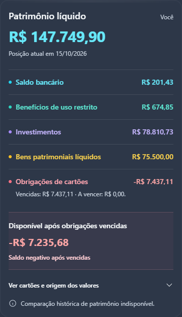

# Patrimônio V2 — refinamento visual

O card da posição atual passa a priorizar o patrimônio líquido e os componentes em linhas curtas. As explicações completas e a origem dos valores permanecem em uma seção nativa de detalhes, recolhida por padrão. A disponibilidade após obrigações vencidas ocupa uma faixa separada.

## Escopo preservado

- Única alteração de runtime: `src/components/dashboard/CurrentNetWorthCard.tsx`.
- Props, valores recebidos, formatação monetária, sinais, condições de completude e recuperação de erro preservados.
- Nenhuma alteração em fórmulas, motor econômico, contratos de dados, fontes, escopo familiar, comparação operacional ou integração de Transações.
- Nenhuma alteração em feature flags, backend, RLS, migrations, Billing ou dependências.
- Dashboard legado e plano técnico do histórico permanecem intactos. A comparação histórica de patrimônio continua indisponível.

As cores reforçam os nomes dos componentes; não substituem rótulos nem sinais monetários. Um saldo bancário positivo continua identificado como “Saldo bancário”. A disponibilidade negativa aparece separadamente com sinal de menos e a mensagem “Saldo negativo após vencidas”. Dados desconhecidos continuam como “—”. Os avisos de carga, erro, fontes incompletas, conciliação e arquivamento permanecem disponíveis.

## Antes e depois

Capturas do mesmo cenário **sintético local**, sem sessões autenticadas ou dados extraídos do banco. Antes: componente de `acd73985387ae0a91226908aa370c22474b087bf`. Depois: implementação desta branch. Mesmo viewport, escala de dispositivo 1 e zoom 100% em cada par; imagens recortadas ao card, sem redimensionamento posterior. A altura varia com o conteúdo.

| Viewport | Antes | Depois |
| --- | --- | --- |
| Desktop · 1280 × 1100 | [Captura](before-desktop.png) | [Captura](after-desktop.png) |
| Mobile · 390 × 844 | [Captura](before-mobile.png) | [Captura](after-mobile.png) |

### Desktop

Antes:

Depois:

### Mobile

Antes:

Depois:

No mobile, a altura do resumo cai de 738 para 625 px (cerca de 15%). O patrimônio permanece em R$ 147.749,90, o saldo bancário em R$ 201,43 e o disponível após vencidas em −R$ 7.235,68 no mesmo cenário antes/depois.

## Regressão e validação visual

O teste de apresentação cobre componentes, sinais, crédito comprovado separado, indisponibilidade parcial, carregamento, erro, avisos e explicações recolhidas. A entrada congelada confirma que o card apresenta os totais recebidos sem recalculá-los.

`scripts/diagnostics/validate-net-worth-preview.py` usa a página sintética `scripts/diagnostics/net-worth-preview.html`, servida por Vite em `127.0.0.1:4181`. Requer Python, Playwright e Edge instalados. Execute com `python scripts/diagnostics/validate-net-worth-preview.py --out-dir <pasta-local>` enquanto o servidor local estiver ativo. Requisições fora dessa origem são bloqueadas, e qualquer tentativa faz a validação falhar.

Foram aprovadas 27 verificações em desktop (1280 px), mobile (390 px) e tela estreita (320 px), incluindo expansão por Enter, recolhimento por Espaço, recuperação por teclado, cenário legado, comparação operacional, valores negativos, fatura futura, cartão quitado, dados parciais e conciliação pendente. Também foram conferidos zoom de 200%, ausência de rolagem horizontal e ausência de erros de página.

A suíte completa, o baseline TypeScript, o build/PWA e `git diff --check` devem passar antes da publicação. Os resultados da execução final e os links do Actions/Preview ficam registrados na descrição do PR.
