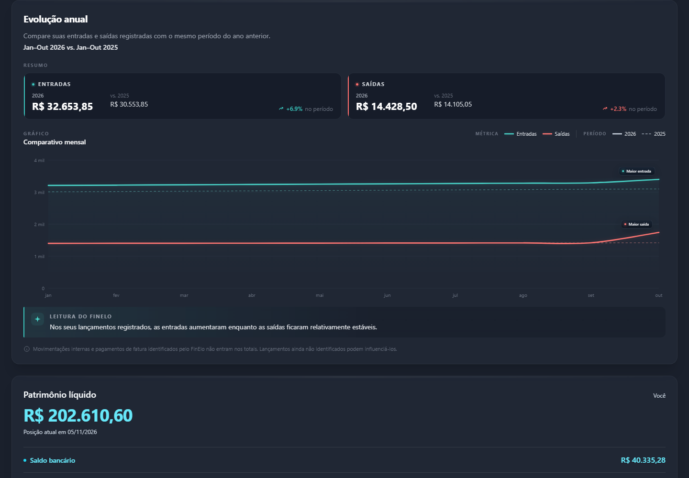
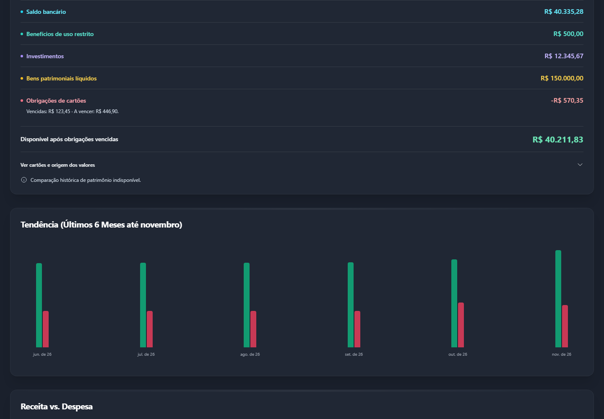
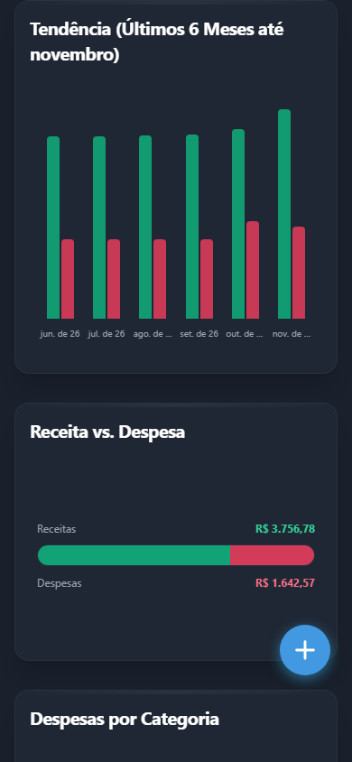
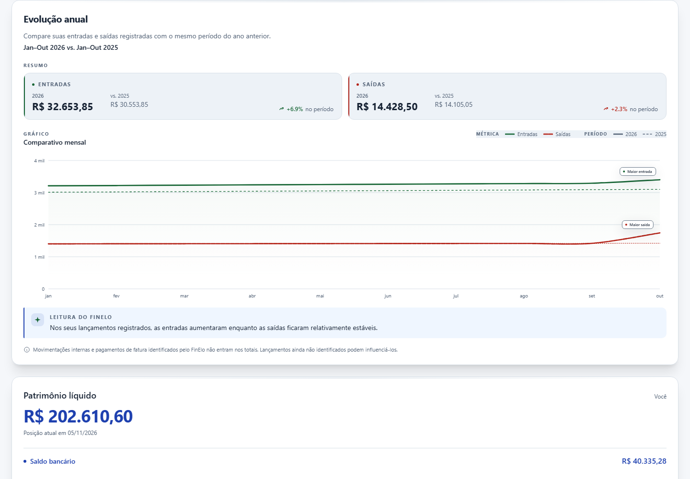
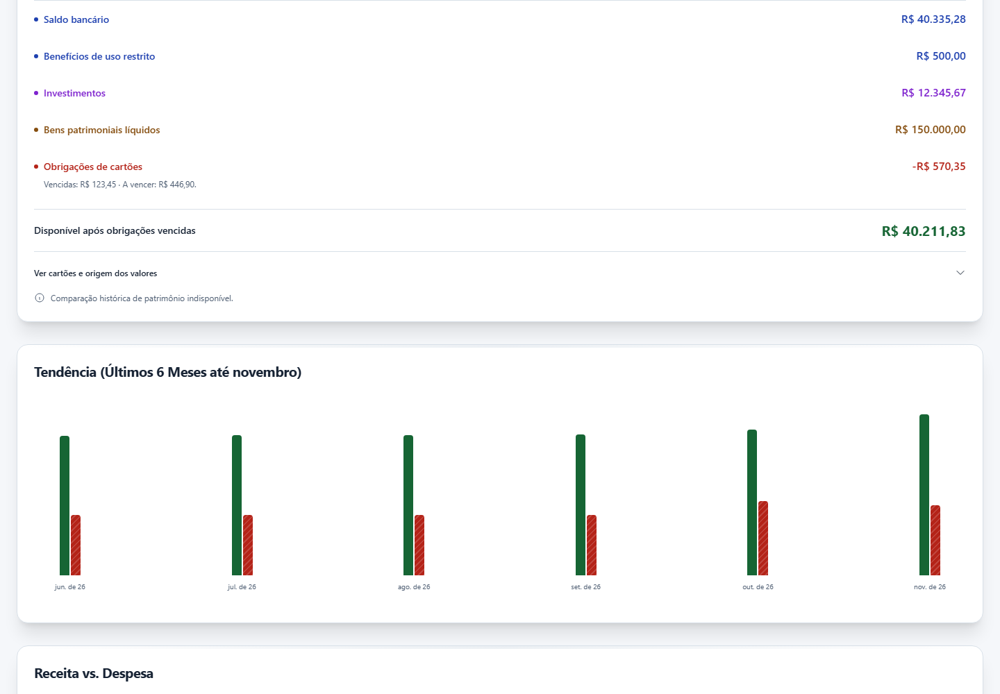
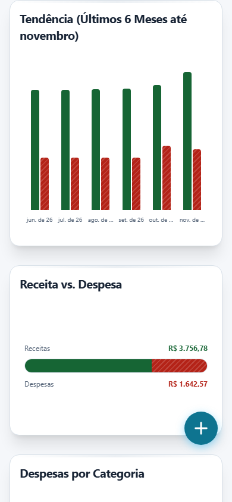

# Ciclo 4A — Dashboard e gráficos

Status: Ciclo 4A concluído para revisão na PR #97 em rascunho, com as limitações anteriores documentadas. Claro global permanece bloqueado; o CI do HEAD entregue é confirmado na PR.

## Escopo e referências

Base aprovada: `7e5f4f262923c1b2f6865c958200bb0a26aca5e9`. Main confirmada e ancestral: `6fa1188b1864e85da587e61c7e46009a5e82adb4`. Snapshots independentes de todas as fontes `src`, com SHA-256 por arquivo, foram preparados antes da edição. As capturas anteriores à edição e os contratos de apresentação também foram registrados antes de converter o Dashboard.

Somente apresentação e acessibilidade. Escuro padrão, coorte e flags de aparência mantidos. Não houve alteração de fórmulas, filtros financeiros, séries, datas, competências, arredondamento, permissões, parsers, serviços financeiros, pagamentos ou conciliação. Sem login real, banco remoto, migration, merge ou deploy.

## Inventário e implementação

| Superfície real | Consumidores e cobertura |
| --- | --- |
| Dashboard | `DashboardView`: filtros mensal/trimestral/semestral/anual/personalizado; comparação; KPIs; orçamento; 50/30/20; alertas; últimas transações; navegação; impressão; FAB/modal reutilizado |
| Patrimônio atual | `CurrentNetWorthCard`, `CurrentNetWorthPanel`, `OwnerScopeNetWorthNote`: posição completa/parcial/erro/carregamento; disponível após vencidos; detalhes de cartões e origem |
| Patrimônio legado | `NetWorthSummaryCard`: contas, investimentos, bens líquidos, composição, comparação e liquidez explicitamente rotuladas |
| Contexto familiar | `DashboardOwnerSelector`, `OwnerScopeControl`: você, titular identificado e família; contexto de leitura/orçamento preservado |
| Evolução e leitura | `AnnualEvolutionCard`, `MonthlyChangeCard`, `UpcomingEntriesCard`: indicadores, deltas, alertas, leitura contextual, períodos e origem |
| Gráficos | `AnnualEvolutionChart`, `MonthlyEvolutionChart`, `IncomeExpenseChart`, `CategorySpendChart`: SVG/HTML próprios; nenhuma biblioteca externa de gráficos |
| Auxiliares | `PeriodCompareColumns`, `PeriodCompareLegend`, `Rule503020Widget`, `BudgetManagerPanel`, `FirstStepsCard`, `SummaryCard`, `ProgressBar` e `TourButton` |
| Portal do tutorial | `DashboardTourAppearance`: ponte de apresentação, sem dependência do store ou de serviços financeiros; acompanha o tema e restaura o portal ao sair |

Os wrappers sem pintura própria (`CurrentNetWorthPanel`, `DashboardOwnerSelector`), `ProgressBar` e `TourButton` são reutilizados e protegidos pelo contrato, sem conversão artificial. `NewTransactionModal`, `AccountModal`, `CategoryModal`, `Modal` e `GlobalDialog` reutilizam as conversões anteriores.

A folha `src/components/appearance/dashboard.css` importa os adaptadores financeiros existentes. Toda a nova pintura fica em `@media screen` e sob `[data-finelo-theme="light"]`. Classes antigas, atributos SVG originais, cores inline antigas, dimensões e contratos de impressão permanecem. Papéis `data-finance` identificam cada consumidor, inclusive as cores dinâmicas das séries e dos segmentos patrimoniais. Não há inversão global, filtros de tema, substituição de classes ou mudança de layout.

Receita e despesa mantêm rótulos e valores; o Claro acrescenta traço e textura distintos. O ano comparado mantém traço e espessura distintos. A composição patrimonial conserva os nomes e os indicadores de liquidez, com textura adicional no Claro. Trilhas e grades são decorativas; linhas, barras, marcadores, legendas e controles essenciais são medidos separadamente.

## Proteção e equivalência financeira

O teste `tests/appearance/dashboardPresentation.spec.ts` protege 22 consumidores por fingerprint AST e 156 módulos por SHA-256 normalizado apenas para LF. O AST exclui somente os acréscimos de apresentação/acessibilidade explicitamente enumerados; conserva classes, estilos inline anteriores, textos financeiros, funções, fórmulas, dependências e callbacks financeiros. A ponte de apresentação nova é analisada e testada como componente de UI.

Os testes existentes de evolução anual foram adaptados para aceitar atributos semânticos antes de `d` e `class`. Continuam verificando as mesmas curvas, lacunas, cores, espessuras, padrões, legenda e geometria. Não se alterou o resultado esperado para acomodar mudanças financeiras.

A referência de staging local instala storage em memória, BroadcastChannel desativado e transporte fechado antes dos imports. SDK, store, seleção de titular, serviços de leitura patrimonial e cálculos originais são reutilizados; somente I/O recebe respostas sintéticas. Rede externa é bloqueada também pelo navegador. Uma sentinela em iframe confere que o storage real permanece intacto. Nenhum token ou cabeçalho de autenticação é registrado.

A observação de props e séries renderizadas usa a árvore Fiber do React de desenvolvimento, somente no diagnóstico. Não recalcula os resultados para produzir a evidência. Séries, posição patrimonial nativa em centavos, breakdown legado, 50/30/20, barras e valores formatados/DOM são comparados nas quatro variantes, com as mesmas fixtures e filtros. A normalização para centavos é apenas de observação. Este uso de API interna fica restrito ao harness e deve ser revisto se o React mudar.

O perfil de troca de CSS confere commits React, chamadas ao cálculo de saldo, requisições, gravações e eventos econômicos. A persistência Auth dos ciclos anteriores não foi reimplementada. Esses testes não certificam banco/RLS ou concorrência remotos.

## Método visual e de contraste

Edge headless, desktop 1440×1000 e mobile 390×844, escala 1, fuso America/Sao_Paulo e relógio fixo em 05/11/2026. Quatro variantes: main, revisada, Escuro e Claro atuais. Animações/transições são desativadas somente pelo validador; fontes, estado, dados e viewport são iguais. Rolagem e ponteiro/foco são posicionados explicitamente antes de capturar.

Paridade exige o mesmo conteúdo, geometria, cores computadas, paint SVG e raster. Somente o sufixo interno de `useId` nas referências de gradiente é normalizado, mantendo a associação ao mesmo gradiente e as cores dos stops. Não há máscara de pixels. Nos estados interativos, a captura recria as camadas de pintura com opacidade temporária do body, restaura exatamente o estilo anterior e conserva o foco e a geometria; isso elimina resíduos do cache do compositor. O estilo final do produto não é alterado. O novo Enter/Espaço é comparado às duas ações de clique equivalentes das referências antigas, seguido da mesma entrada por Tab/foco visível; as teclas não eram suportadas anteriormente. A tolerância pequena do 3A só pode ser aplicada após verificar identidade de geometria/conteúdo/pintura.

Texto/campos/placeholder: mínimo 4,5:1, inclusive textos grandes (limiar conservador). Controles, foco e gráficos essenciais: mínimo 3:1. A cor de texto SVG é `fill`; linhas usam `stroke`, opacidade própria/herdada e fundo efetivo. A medição das barras considera também os pontos claros das texturas. Os dados brutos e falhas anteriores do Escuro ficam no pacote, separados do resultado Claro.

A prévia Premium desfocada e inativa é excluída do contraste de conteúdo disponível, conforme a exceção incidental/inactive de [WCAG 1.4.3](https://www.w3.org/WAI/WCAG22/Understanding/contrast-minimum.html). O overlay, títulos, mensagens e CTA são auditados. O bloqueio de acesso não é removido para passar no teste. As três regiões preservam a condição Premium anterior e usam `inert` para impedir os novos pontos de foco nas prévias indisponíveis; o overlay/CTA continua acessível. É uma proteção de apresentação, sem mudar planos, permissões ou conteúdo financeiro.

## Ajustes indispensáveis de acessibilidade

Os textos existentes dos hints passaram a ser alcançáveis por foco, com nome acessível, atendendo aos comportamentos verificáveis de [WCAG 1.4.13](https://www.w3.org/WAI/WCAG22/Understanding/content-on-hover-or-focus.html). Escape fecha o conteúdo sem mover o foco; mover o ponteiro sobre o popup conserva sua leitura; sair do trigger permite abri-lo novamente. O gráfico anual responde a Enter/Espaço e Escape; seu mouseleave conserva o tooltip enquanto o teclado permanece no gráfico. Os meses do gráfico de barras expõem também os valores do período comparado em seu nome acessível.

São mudanças de interação justificadas por acesso ao conteúdo existente, sem texto financeiro novo ou geometria diferente. As pequenas regras de disclosure/pointer-events funcionam nos dois temas, dentro de `@media screen`, e constituem a exceção explícita à restrição de novas regras somente no Claro. Não alteram a pintura Escura em repouso/hover. A validação compara os estados legados equivalentes e testa separadamente as novas ações por teclado.

O callback de UI `onMouseLeave` e o atributo de acessibilidade `inert` foram adicionados às exclusões de apresentação do contrato AST para permitir a persistência por foco e conservar a inatividade da prévia Premium. Os fingerprints foram derivados novamente **das fontes imutáveis de 7e5f4f2**, nunca das fontes atuais. Os 156 selos financeiros e todos os corpos de cálculo/série continuaram integrais.

O detector Impeccable foi executado uma vez ao terminar a UI: três avisos `gray-on-color` referem-se às classes legadas dos botões de revisão patrimonial/Premium. Essas classes são conservadas por contrato; o Claro usa os papéis semânticos de superfície/ação, medidos no navegador. Não se fez redesign nem correção de identidade Escura para silenciar o detector.

## Resultado consolidado e matriz de aceite

**PASS para revisão do Ciclo 4A**, com a limitação mobile preexistente indicada abaixo. PR #97 permanece em rascunho; não há autorização de Claro global ou publicação.

- 528 capturas da interface, desktop/mobile e quatro variantes, mais 26 rasters de páginas PDF e 14 capturas anteriores à edição. O pacote guarda imagens idênticas uma única vez e mantém todos os nomes/SHAs no mapa de capturas.
- 250 paridades Escuras: 247 exatas; 3 diferenças dentro do limite já aprovado no 3A, com conteúdo/geometria/cores/paint SVG iguais. Detalhes: states/mobile-yearly-compare-dark: 5 pixels, delta máximo 2; extras/desktop-long-period-dark: 9 pixels, delta máximo 1; extras/mobile-long-period-dark: 3 pixels, delta máximo 1. Nenhuma tolerância maior foi usada.
- 49146 amostras de contraste Claro aprovadas (1023 observações distintas por tipo/texto/razão/limiar), incluindo repetições entre estados e rolagens. Mínimos 5.122:1 para texto/campos e 3.409:1 para elementos essenciais/foco. Zero falhas.
- 368 snapshots financeiros comparados e 186 trocas de pintura com zero commits React, cálculo de saldo, consulta, gravação ou evento econômico adicional. A medição é da pintura isolada; não é uma nova homologação do Auth remoto.
- 28 verificações de hint com Escape, hover, persistência e foco conservado, além das ativações/foco SVG, meses, seletores e campos nativos. Três regiões Premium inertes, com overlay disponível.
- 12 PDFs/52 páginas: dimensões, texto, valores, datas, desenhos e raster iguais. Zero requisição externa ou erro JavaScript não tratado.

| Cenário solicitado | Visual Claro/Escuro desktop e mobile | Valores/payloads |
| --- | --- | --- |
| 1. Movimentação completa | PASS | PASS |
| 2. Sem transações | PASS | PASS |
| 3. Positivo, negativo e zero | PASS | PASS |
| 4. Disponibilidade negativa | PASS | PASS |
| 5. Futuras e vencidas | PASS | PASS |
| 6. Múltiplas contas | PASS | PASS |
| 7. Cartões, saldos e pagamentos | PASS | PASS |
| 8. Investimentos no patrimônio | PASS | PASS |
| 9. Você/titular/família | PASS | PASS |
| 10. Anual, período longo e categorias extensas | PASS | PASS |
| 11. Séries incompletas/ausentes | PASS | PASS |
| 12. Erros e recuperação | PASS | PASS |
| 13. Carregamento prolongado e liberação | PASS | PASS |
| 14. Filtros e comparação alterados | PASS com ressalva de rolagem anterior | PASS |
| 15. Dashboard → Transações/Importação → Dashboard | PASS | PASS |

Também aprovados: patrimônio atual e legado; fontes parciais; revisão patrimonial; convite; três fases do onboarding; prévias Premium; orçamento aberto/cancelado, validação negativa, criação e erro de persistência modelados. O orçamento percorre os callbacks/store originais, com POST/resposta sintéticos, sem escrita remota. Não houve mudança de permissão.

A rolagem horizontal de **86 px a 390 px** ocorre no filtro personalizado/período longo nas quatro variantes. Continua possível acessar os controles por rolagem/foco; não se introduziu nem se corrigiu a geometria neste lote. Paridade não transforma essa limitação em aprovação de responsividade plena.

As deficiências de contraste Escuras anteriores permanecem nos audits brutos: rótulos pequenos/cinzas, percentuais de categorias, legenda e séries comparadas/linhas translúcidas, além de alguns estados de foco. Foram comprovadas por classes/cores e raster equivalentes, sem clarear a identidade original. Os mesmos consumidores disponíveis passam no Claro. O resultado não representa uma certificação WCAG de dispositivos/leitores de tela ainda não ensaiados.

## Testes e CI

| Validação | Resultado |
| --- | --- |
| Suíte completa local | PASS — 3.328 testes / 206 arquivos |
| Focal Dashboard/orçamento/aparência/comparação | PASS — 554 testes / 28 arquivos, extraídos da mesma execução completa |
| Temas anteriores e proteção nova | PASS — 116 testes / 8 arquivos na suíte completa |
| Último atributo `inert` + contrato/gráfico anual | PASS — 118 testes / 3 arquivos reexecutados, TypeScript e build novamente |
| TypeScript | PASS — 14 diagnósticos conhecidos, zero novos |
| Build/PWA | PASS — 49 entradas de precache; aviso de tamanho de chunk já existente |
| Contratos | PASS — 22 AST e 156 selos financeiros |
| CI do HEAD entregue | [Checks da PR #97](https://github.com/CassMach13/FinElo/pull/97/checks); execução/SHA exatos confirmados na descrição da PR |

A primeira execução local passou 3.235 testes e não coletou duas suítes por seletores dependentes da ordem dos atributos SVG. Os seletores foram corrigidos mantendo os mesmos resultados esperados; a execução completa seguinte passou 3.328/206. O atributo final `inert` foi revalidado pelos 118 testes focais e pelo CI do HEAD entregue. Não se alteraram timeouts, migrations ou testes financeiros para obter aprovação.

A diferença eventual entre local e CI é anterior: o CI ignora um CSV privado e não dispõe de 19 casos parametrizados de extratos privados locais. Nenhum desses arquivos pessoais foi incluído nas evidências ou no Git.

## Evidências e reprodução

[Resumo e métricas verificáveis](evidencias-ciclo-4a/validacao.json) · [Envelope/SHA-256 do pacote completo](evidencias-ciclo-4a/pacote.json) · [Mapa de capturas](evidencias-ciclo-4a/capturas.json) · [Índice de arquivos e hashes](evidencias-ciclo-4a/indice.json).

| Desktop anual | Desktop patrimônio | Mobile gráficos |
| --- | --- | --- |
|  |  |  |
|  |  |  |

Preparar referências com `prepare-financial-baseline.py --base <SHA> --target-name theme-dashboard-main-baseline` e `theme-dashboard-reviewed-baseline`; o script verifica hashes e não sobrescreve uma referência divergente. Iniciar `serve-card-preview.ps1 -Port 5205`, que usa somente URL/chave fictícias, e executar `validate-dashboard-themes.py --out-dir <pasta>` com `--suite states|extras|interactions|a11y|premium`, `--viewport desktop|mobile|all` e `--themes all|light`. Usar `validate-dashboard-print.py` para os 12 PDFs. Playwright/Edge e PyMuPDF são ferramentas de diagnóstico, instaladas temporariamente, sem nova dependência de aplicação.

Os manifestos completos, audits, payloads, fontes atuais/referências, capturas anteriores à edição, PDFs/textos/rasters, logs e versões ficam no ZIP externo. PNGs idênticos são deduplicados por conteúdo; o mapa preserva cada captura lógica e permite reconstruí-la pelo SHA-256. O ZIP é reaberto e conferido por CRC e pelo hash de cada entrada. Os arquivos temporários e o servidor exclusivo são removidos após a verificação.

## Impressão

Doze PDFs: posição atual, legado com comparação anual e contexto familiar, em cada uma das quatro variantes. O resultado inicial comparado foi 52 páginas: 4/5/4 páginas por variante. Quantidade, dimensões, texto, valores, datas, desenhos e raster são comparados. Os gráficos precisam ter SVG e paths visíveis no modo de impressão. O botão real Exportar PDF é exercitado com `window.print` observado no harness.

A estabilização de captura aguarda a pintura final após interação/rolagem. Falhas transitórias acima do limite não foram aprovadas nem usadas para ampliar a tolerância; os casos foram reproduzidos e executados novamente após estabilização.

As folhas novas são somente de tela; o PDF mantém a aparência Escura anterior. Nenhum seletor de impressão existente é alterado. Páginas representativas devem ser inspecionadas visualmente, além da comparação automática integral.

## Limitações e escopo seguinte

O filtro de datas personalizadas mobile apresenta rolagem horizontal do documento nas referências anteriores e no código atual. A matriz registra esse caso e sua largura por variante, sem corrigir layout financeiro neste lote. No gráfico mensal, o período personalizado mantém os seis buckets definidos na implementação anterior; o agregado e os comparativos do período longo são preservados, sem reescrever a série.

A equivalência financeira não aprova bugs preexistentes. Os avisos de conciliação, OFX, consentimento secundário e outros riscos legados continuam documentados nos relatórios anteriores, sem correção funcional neste lote.

A homologação mobile aqui é de viewport Edge, sem equivalência presumida a Safari/iOS/Android físicos. Leitores de tela reais, orientação, teclado móvel, instalação/standalone e capturas em dispositivos físicos seguem para a homologação transversal. Build/PWA não substitui esses ensaios. O Claro continua indisponível para usuários reais.

## Plano detalhado do Ciclo 4B

1. **Inventário e baseline independente.** Mapear Investimentos, carteiras/posições, bens e demais telas ainda não convertidas; confirmar novo HEAD/main, capturar estados antes de editar e selar cálculos/serviços. Manter os adaptadores de 4A sem ampliar a coorte.
2. **Investimentos e patrimônio.** Converter pintura de filtros, tabelas, gráficos e formulários/auxiliares; estados vazio, erro, carregamento, vínculos familiares, titular/consolidação e restrições de edição. Não alterar valorização, contribuições, snapshots, dívida, liquidez, ownership, classificações ou RLS.
3. **Consumidores restantes.** Cobrir metas, configurações, ajuda, onboarding fora do Dashboard, plano/assinatura e telas secundárias conforme inventário real. Reutilizar tokens; conferir todos os portais e controles nativos. Separar qualquer correção funcional legada em tarefa própria.
4. **Evidências por sublote.** Fixtures sintéticas, payloads/resultados em centavos, main/revisado/Escuro/Claro, desktop/mobile, contraste computado e teclado. Escuro com conteúdo/geometria/cores/raster preservados; toda exceção indispensável precisa de justificativa explícita. PDFs com páginas, dimensões, texto, desenhos e raster iguais. Evidência compacta no Git e pacote externo com índice/CRC/SHA-256.
5. **Homologação transversal.** Safari/iOS, Android/Chrome e desktop; leitores de tela; zoom e texto longo; foco, tooltip, toque, nativos, orientação, PWA instalada, offline/retorno e atualização do service worker. Verificar isolamento da preferência por conta e confirmar zero consultas financeiras por pintura.
6. **Piloto e decisão de publicação.** Somente após telas completas e matriz aprovada: piloto restrito às contas autorizadas de staging, Escuro padrão e rollback pela flag já existente. Sem nova migration. Publicação geral requer autorização explícita posterior, CI verde e revisão das limitações. Rollback do Claro não deve modificar dados, preferências financeiras ou cálculos.

Aceite por sublote: todas as superfícies do inventário legíveis no Claro; paridade Escura demonstrada; centavos/payloads iguais; contraste e teclado aprovados; contratos financeiros e de impressão preservados; suíte/TypeScript/build/PWA aprovados. Não habilitar o Claro parcialmente convertido.
